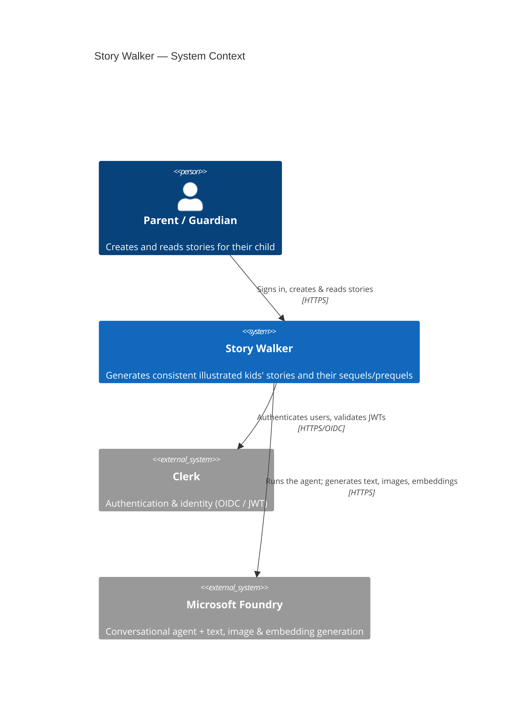
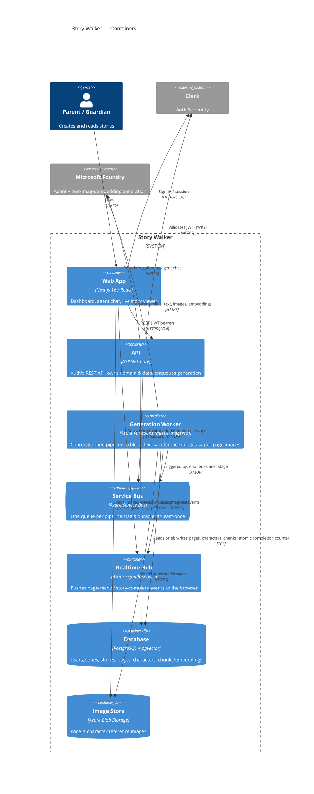

# C4 — System Context & Containers

C4 model (Levels 1 & 2) for Story Walker, in Mermaid. Level 1 shows the system in its
environment; Level 2 shows the deployable containers and how they collaborate. A generation
sequence diagram is included to make the asynchronous flow concrete.

> See the ADRs in [`../adr`](../adr) for the rationale behind each container and dependency.

## Level 1 — System Context



## Level 2 — Containers



## Generation flow (asynchronous choreography)

Concrete sequence for creating a story, including the parallel image fan-out and the
exactly-once completion. See [ADR-0004](../adr/0004-plain-azure-functions-choreography.md)
and [ADR-0005](../adr/0005-completion-counter-idempotency-deadletter.md).

```mermaid
sequenceDiagram
    autonumber
    actor U as Parent (Browser)
    participant API as ASP.NET Core API
    participant SB as Service Bus
    participant F as Azure Functions
    participant AI as Microsoft Foundry
    participant DB as PostgreSQL
    participant BL as Blob Storage
    participant SR as SignalR

    U->>API: Agent brief complete (create story)
    API->>DB: Insert Story (status=Generating, page_count=N)
    API->>SB: Enqueue "bible" {storyId}
    API-->>U: 202 Accepted
    U->>SR: Subscribe to story {storyId}

    SB->>F: trigger Fn_GenerateBible
    F->>AI: Generate bible (chars, style, outline)
    F->>DB: Save bible / series
    F->>SB: Enqueue "text" {storyId}

    SB->>F: trigger Fn_GenerateText
    F->>AI: Generate full story (single pass)
    F->>DB: Save N Page rows (text)
    F->>SB: Enqueue "refimage" {storyId}

    SB->>F: trigger Fn_GenerateRefImage
    F->>AI: Generate reference image(s) for new characters
    F->>BL: Upload reference image(s)
    F->>DB: Save reference_image_url + seed
    F->>SB: Enqueue N x "pageimage" {storyId, pageNo}

    par Parallel per-page (fan-out)
        SB->>F: trigger Fn_GeneratePageImage (pageNo)
        F->>DB: Already complete? (idempotency guard)
        F->>AI: Generate page image (bible + ref + seed + text)
        F->>BL: Upload page image
        F->>DB: Page=Complete; UPDATE completed_pages+1 RETURNING
        F->>SR: page-ready {pageNo, imageUrl}
        SR-->>U: page-ready
    end

    Note over F,DB: The instance whose RETURNING == N completes the story
    F->>DB: Story=Complete
    F->>SR: story-complete {storyId}
    SR-->>U: story-complete
```
