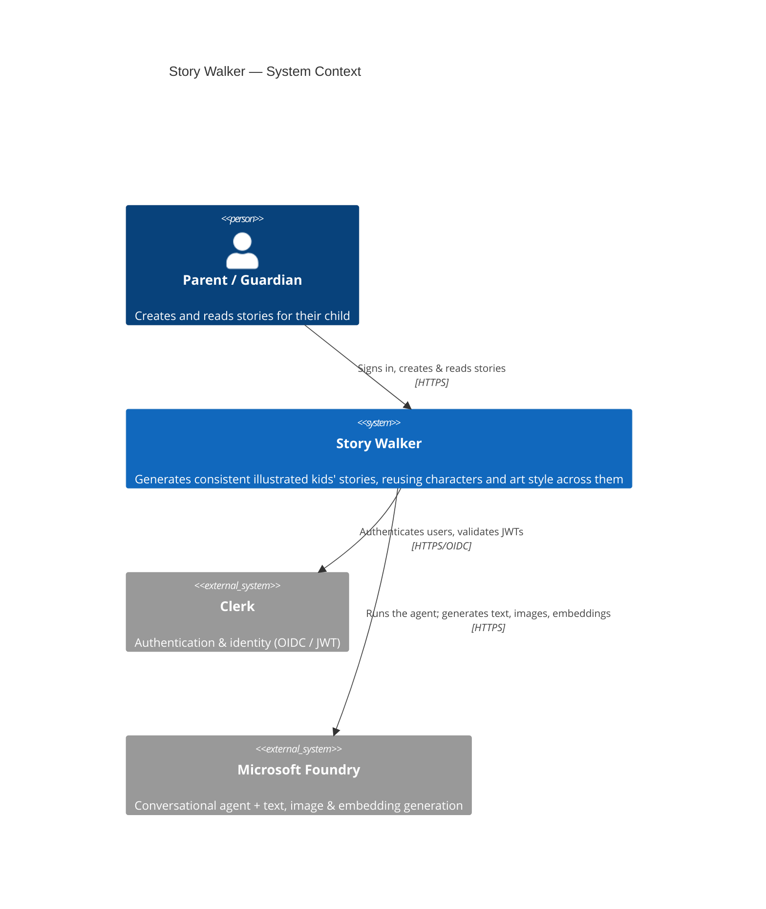
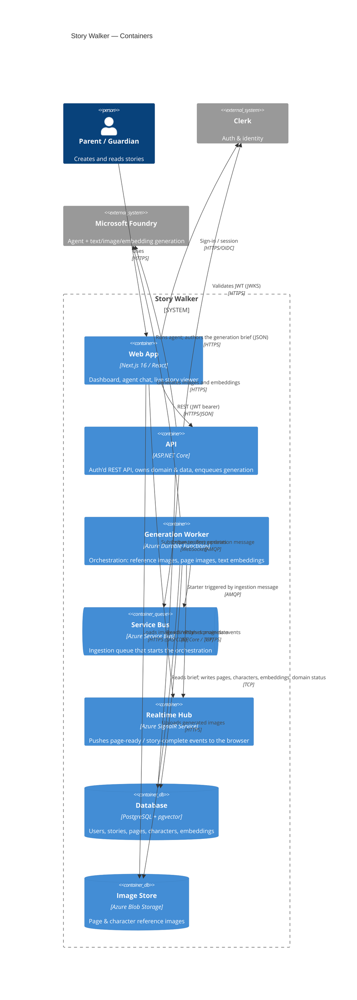
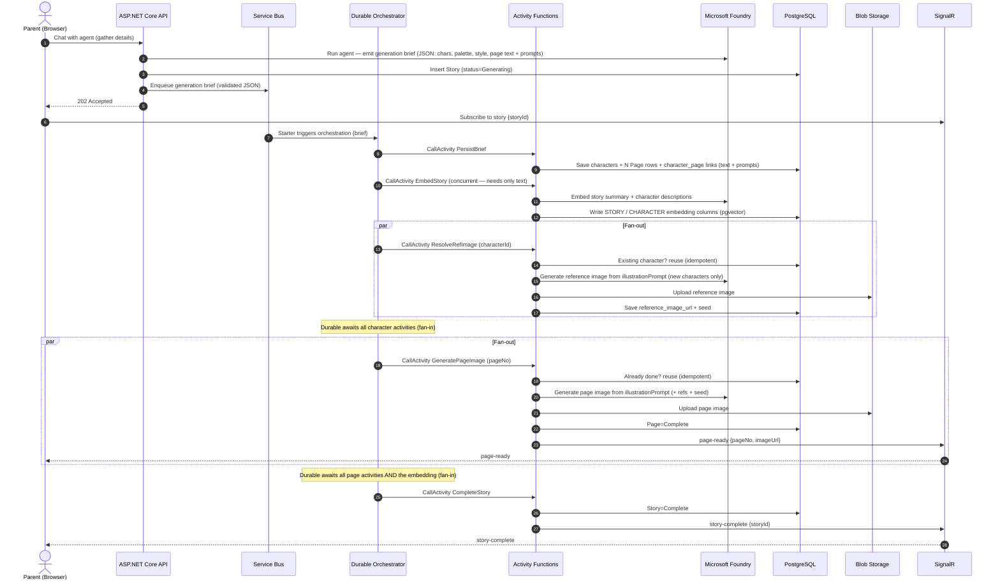

# C4 — System Context & Containers

C4 model (Levels 1 & 2) for Story Walker, in Mermaid. Level 1 shows the system in its
environment; Level 2 shows the deployable containers and how they collaborate. A generation
sequence diagram is included to make the asynchronous flow concrete.

> See the ADRs in [`../adr`](../adr) for the rationale behind each container and dependency.

## Level 1 — System Context

## Level 2 — Containers

## Generation flow (Durable Functions orchestration)

Concrete sequence for creating a story: the orchestrator drives the ordered stages and uses
`Task.WhenAll` for the two parallel fan-out/fan-in stages (character reference images, then
per-page images). See [ADR-0004](../adr/0004-durable-functions-for-generation.md)
and [ADR-0005](../adr/0005-idempotency-and-failure-handling.md).

