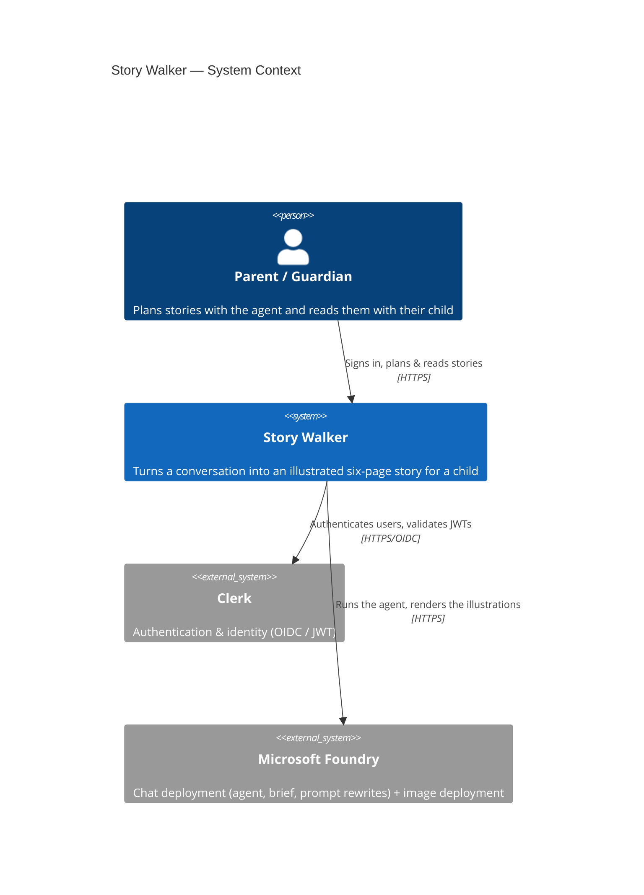
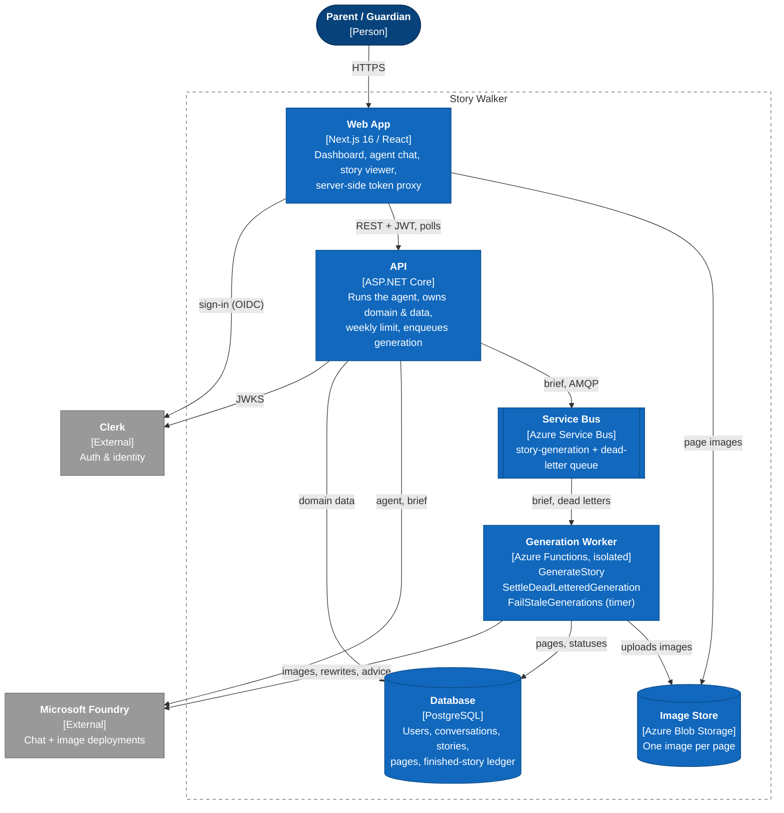
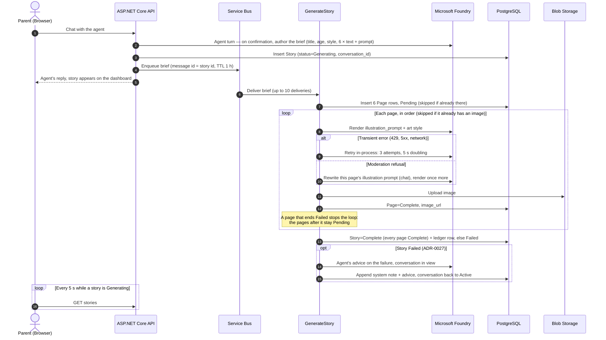
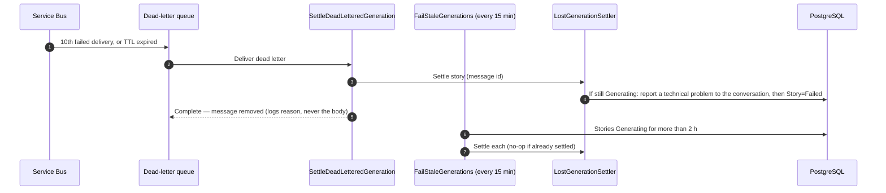

# C4 — System Context & Containers

C4 model (Levels 1 & 2) for Story Walker, in Mermaid. Level 1 shows the system in its
environment; Level 2 shows the deployable containers and how they collaborate. Two sequence
diagrams make the asynchronous generation concrete: the normal run, and what happens to a story
whose message is lost.

> See the ADRs in [`../adr`](../adr) for the rationale behind each container and dependency.

## Level 1 — System Context

## Level 2 — Containers

Drawn as a `flowchart` in C4 notation (person, containers, external systems) rather than
`C4Container`, whose fixed layout piles the relationship labels on top of each other.

- **Web App → API.** Every call goes through a Next.js Route Handler that adds the Clerk JWT
  server-side ([ADR-0021](../adr/0021-clerk-integration.md)).
- **API → Foundry.** The chat deployment runs the agent and, on confirmation, authors the generation
  brief ([ADR-0013](../adr/0013-agent-authored-generation-brief.md)).
- **API → Service Bus.** One message per story on `story-generation`: the brief as the body, the
  story id as the message id ([ADR-0003](../adr/0003-async-generation-via-service-bus.md)).
- **Service Bus → Worker.** `GenerateStory` is triggered by the queue; `SettleDeadLetteredGeneration`
  by its dead-letter queue ([ADR-0032](../adr/0032-settle-and-remove-dead-lettered-messages.md)).
  `FailStaleGenerations` runs on a timer ([ADR-0031](../adr/0031-fail-stories-stuck-in-generating.md)).
- **Worker → Foundry.** The image deployment renders the pages; the chat deployment rewrites a
  refused illustration prompt ([ADR-0025](../adr/0025-rewrite-illustration-prompt-after-moderation.md))
  and writes the advice for a failed story
  ([ADR-0027](../adr/0027-failed-story-returns-to-its-conversation.md)).
- **Worker → Database.** Pages, page and story statuses, the finished-story ledger, and failure
  reports appended to the conversation.

Progress reaches the browser by **polling**, not yet by SignalR
([ADR-0006](../adr/0006-azure-signalr-for-realtime.md) is not built): the dashboard reloads the story
list every 5 seconds while any story is `Generating`.

## Generation flow

One Service Bus-triggered function, no orchestrator
([ADR-0020](../adr/0020-plain-service-bus-function-for-generation.md)). The database is the
checkpoint: a redelivered message skips the pages already written and the images already rendered
([ADR-0005](../adr/0005-idempotency-and-failure-handling.md)). Pages render **one at a time**, and
the first page that fails stops the run
([ADR-0026](../adr/0026-one-failed-page-fails-the-story.md)).

## Lost messages

An exception the worker does not catch abandons the message; after ten deliveries Service Bus
dead-letters it. A message not picked up within its one-hour TTL is dead-lettered too. Either way
the story is settled at once from the dead-letter queue, and the message is removed
([ADR-0032](../adr/0032-settle-and-remove-dead-lettered-messages.md)). A timer is the backstop for
anything that loses a message another way
([ADR-0031](../adr/0031-fail-stories-stuck-in-generating.md)).

