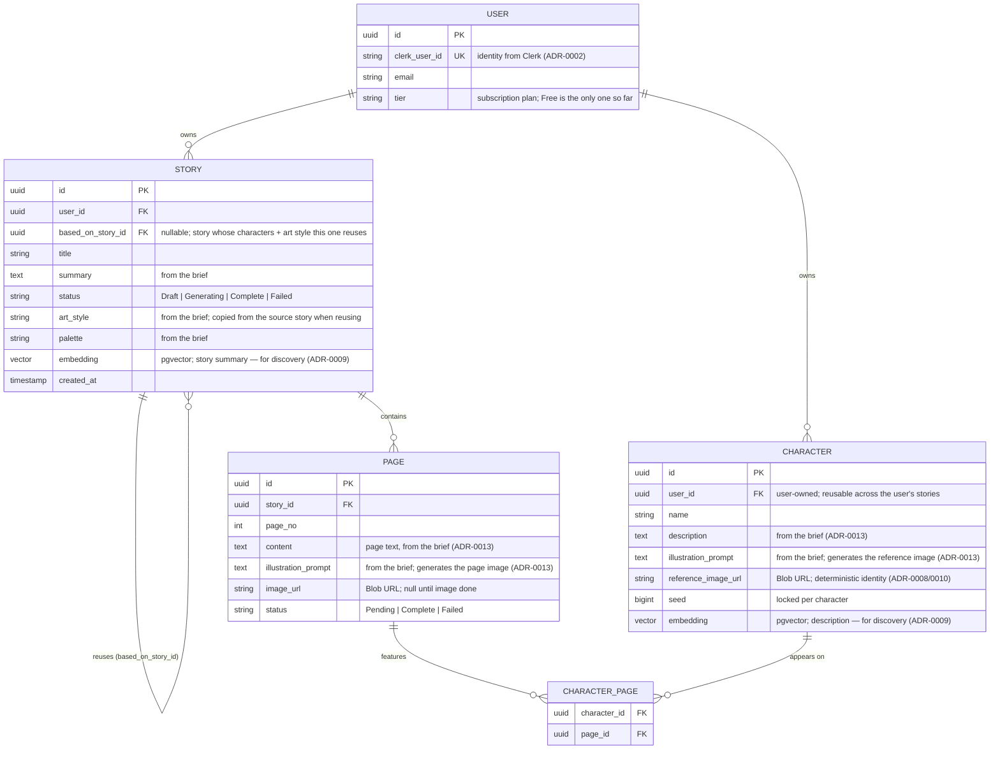

# Entity-Relationship Diagram

Minimal logical data model for Story Walker (PostgreSQL + `pgvector`), in Mermaid. A story may
**reuse** characters and art style from another story; characters are user-owned and shared
across stories. `pgvector` embeddings power semantic discovery of reusable stories/characters.

> Rationale lives in the ADRs — notably
> [0008](../adr/0008-per-character-reference-images.md) (characters & reference images),
> [0009](../adr/0009-postgresql-pgvector-continuity.md) (reuse & embeddings), and
> [0013](../adr/0013-agent-authored-generation-brief.md) (brief-sourced text & prompt fields).

## Notes

- **Ownership & reuse.** A `USER` owns `STORY` and `CHARACTER`. Characters are **user-owned and
  reusable** across the user's stories — a story uses a character by linking it to that story's
  pages (`CHARACTER_PAGE`). A new story can **reuse** another story's characters and art style;
  `STORY.based_on_story_id` records the source (nullable). There is no "series" and no
  sequel/prequel concept — just reuse.
- **Per-character consistency.** `reference_image_url` and `seed` on `CHARACTER` give a
  character its **deterministic identity**; reuse is by linking the existing row, never by a
  similarity match (ADR-0008). `CHARACTER_PAGE` records which characters appear on each page so
  the image step conditions on exactly the right reference images.
- **Brief-sourced fields.** The agent-authored generation brief (ADR-0013) populates
  `STORY.art_style`/`palette`, each `CHARACTER.description`/`illustration_prompt`, and each
  `PAGE.content`/`illustration_prompt`. The brief is a transport format only — it is **not**
  persisted as a column; the normalized rows are the source of truth.
- **Generation status.** `STORY.status` and `PAGE.status` reflect progress. Fan-in is handled
  by the Durable Functions orchestrator (`Task.WhenAll`), **not** DB counters (ADR-0004/0005);
  these columns are the dashboard's source of truth if a SignalR event is missed (ADR-0006).
- **Semantic discovery.** The `embedding` columns on `STORY` (a story-summary vector) and
  `CHARACTER` (a description vector) hold `pgvector` values with an HNSW index. They power
  _discovery_ — finding relevant prior stories and reusable characters — while reuse/identity
  itself is always the deterministic FK link, not the similarity score (ADR-0009). One vector
  per row (no chunk-level retrieval); a separate chunk table would be reintroduced only if
  long/chaptered stories later need passage-level search. Query the vector column only when
  doing similarity search. Scoped by owner.
- **Images** are bytes in Blob Storage; the DB stores only URLs (`PAGE.image_url`,
  `CHARACTER.reference_image_url`) — ADR-0010.
