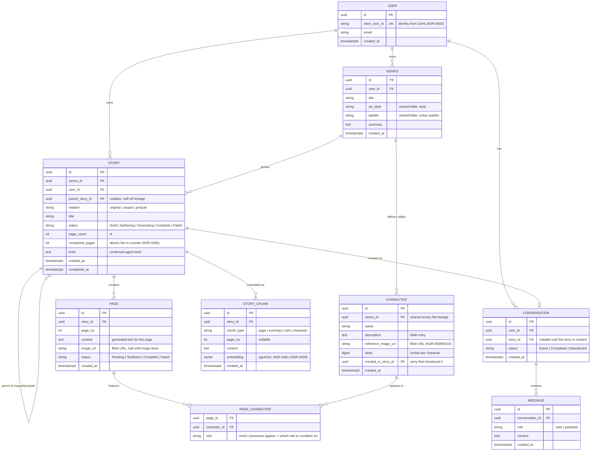

# Entity-Relationship Diagram

Logical data model for Story Walker (PostgreSQL + `pgvector`), in Mermaid. It captures the
story **lineage** (sequels/prequels), the **per-character** consistency model, the
**asynchronous generation** status fields, the **agent conversation**, and the **embeddings**
used for retrieval.

> Rationale lives in the ADRs — notably
> [0005](../adr/0005-completion-counter-idempotency-deadletter.md) (status/counter fields),
> [0008](../adr/0008-per-character-reference-images.md) (characters & reference images), and
> [0009](../adr/0009-postgresql-pgvector-continuity.md) (lineage & embeddings).

## Notes

- **Lineage.** `STORY.parent_story_id` is a self-referencing FK; `relation` records whether a
  story is an `original`, `sequel`, or `prequel`. All stories of one lineage share a `SERIES`,
  which owns the bible-level style and the `CHARACTER` set — so sequels inherit characters and
  art style automatically and only *append* new characters.
- **Per-character consistency.** Reference images and seeds live on `CHARACTER`, not on
  `STORY`. `PAGE_CHARACTER` records which characters appear on each page so the image step
  conditions on exactly the right reference images (ADR-0008).
- **Async generation.** `STORY.status` + `STORY.completed_pages` and `PAGE.status` drive the
  choreographed pipeline and the atomic fan-in (ADR-0004 / ADR-0005). They are also the
  source of truth the dashboard reconciles against if a SignalR event is missed (ADR-0006).
- **Retrieval.** `STORY_CHUNK.embedding` is a `pgvector` column (with an HNSW/IVFFlat index)
  holding per-page, summary, lore, and character embeddings used by RAG when generating a
  sequel/prequel (ADR-0009). Retrieval is always scoped by `user_id` and lineage.
- **Images** are bytes in Blob Storage; the DB stores only URLs (`PAGE.image_url`,
  `CHARACTER.reference_image_url`) — ADR-0010.
