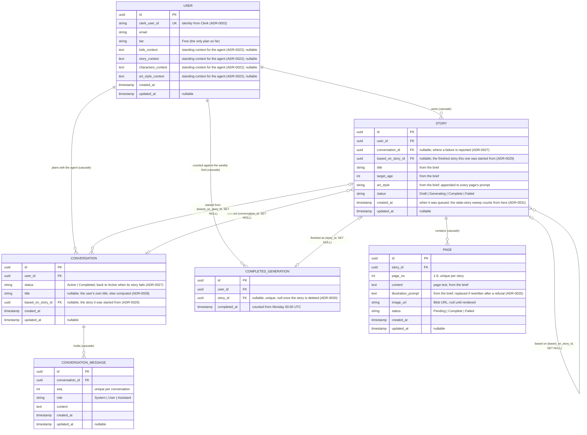

# Entity-Relationship Diagram

Logical data model for Story Walker (PostgreSQL), in Mermaid. Every story is **self-contained**: it
owns its six pages and shares no characters, embeddings or reference images with any other story
([ADR-0019](../adr/0019-mvp-scope-reduction.md)). A story can be *based on* a finished one, which
copies that story's text and prompts into a new conversation, not a link between their rows
([ADR-0029](../adr/0029-stories-based-on-a-previous-one.md)).

> Rationale lives in the ADRs — notably
> [0013](../adr/0013-agent-authored-generation-brief.md) (brief-sourced fields),
> [0018](../adr/0018-persist-agent-conversations.md) and [0028](../adr/0028-conversation-history.md)
> (conversations), [0027](../adr/0027-failed-story-returns-to-its-conversation.md) (failures reported
> to the conversation), and [0030](../adr/0030-weekly-story-limit.md) (the finished-story ledger).

## Notes

- **Self-contained stories.** There is no character table: a character's appearance lives only
  inside the page prompts that describe it, restated in full on every page, which is the whole
  consistency mechanism (ADR-0019). A story *based on* another copies that story's text and prompts
  into the new conversation; `based_on_story_id` only records where it came from, and becomes null
  if the original is deleted.
- **Brief-sourced fields.** The agent-authored generation brief (ADR-0013) populates
  `STORY.title`/`target_age`/`art_style` and each `PAGE.content`/`illustration_prompt`. The brief is a
  transport format — the Service Bus message body — and is **not** persisted as a column; the rows
  are the source of truth.
- **Generation status and checkpoint.** `PAGE.status` and `PAGE.image_url` are the worker's
  checkpoint: a redelivered message skips pages that exist and images already rendered
  (ADR-0005/0020). A story is `Complete` only when every page is; one failed page fails it, and a
  failed story can only be deleted (ADR-0026). A story still `Generating` because its message was
  lost is failed from the dead-letter queue, or by the timer two hours after `created_at`
  (ADR-0031/0032).
- **Conversations outlive their stories.** Deleting a story does not delete the conversation that
  queued it, nor the reverse: `conversation_id` and `based_on_story_id` are `SET NULL`
  (ADR-0028). A failed story's conversation gets a hidden system message and the agent's advice
  appended, and goes back to `Active`.
- **The weekly limit** counts `COMPLETED_GENERATION` rows since Monday 00:00 UTC, plus stories still
  `Generating`. The row stays when its story is deleted (`story_id` becomes null), which is the
  ledger's whole point (ADR-0030).
- **Standing context.** The four `*_context` columns on `USER` are free text the user saves once
  on their settings page. They are composed into the system message of every *new* agent
  conversation and frozen there, so editing them never rewrites a chat in flight (ADR-0022).
- **Timestamps** are stamped by the DbContext, never by callers: `created_at` on insert,
  `updated_at` on every update. `COMPLETED_GENERATION` has only `completed_at`.
- **Images** are bytes in Blob Storage; the DB stores only `PAGE.image_url` (ADR-0010).
